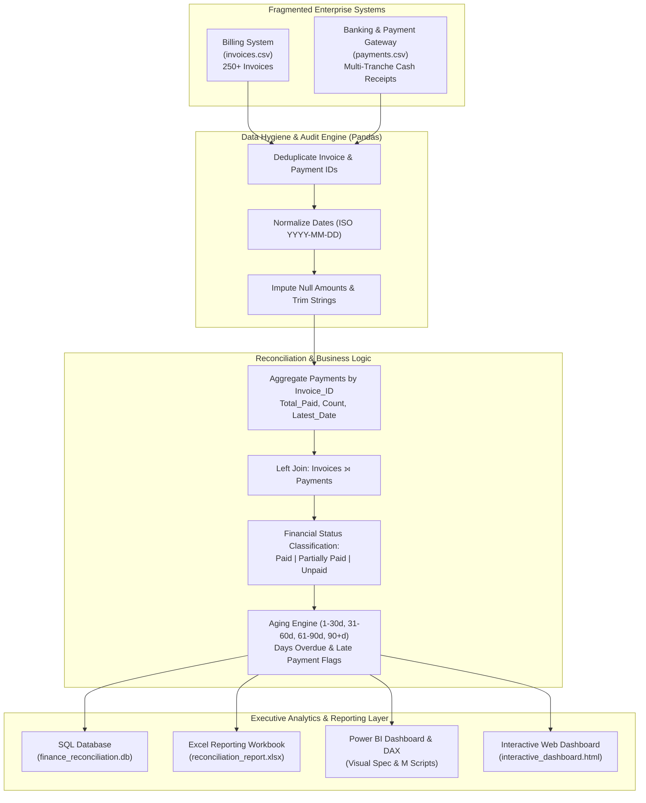

# Invoice–Payment Reconciliation & Revenue KPI Dashboard
> **Cross-System Financial Data Integration, Cash Reconciliation & Executive Analytics**  
> *Tools: SQL, Python (Pandas), Excel, Power BI, Statistics & Financial Analytics*

---

## 📌 Executive Summary & Business Context

In corporate finance and management consulting (e.g., Crowe, Big 4, FP&A advisory), enterprise organizations frequently maintain fragmented data systems:
- **ERP / Billing Systems** (Salesforce, SAP, Oracle NetSuite) issue invoices and track accounts receivable (AR).
- **Payment Gateways & Banking Systems** (Stripe, UPI, SWIFT, ACH portals) record incoming cash settlements independently.

Without an automated reconciliation layer, financial reporting suffers from **data silos**, unallocated payments, inaccurate cash flow velocity forecasting, and delayed delinquency management.

This project delivers an end-to-end, production-grade **Financial Intelligence & Reconciliation Pipeline**:
1. **Automated ETL & Reconciliation (Python/Pandas)**: Cleans dirty records, eliminates duplicates, handles multi-tranche partial settlements, parses mixed date formats, and computes financial risk metrics (`Outstanding_Amount`, `Payment_Status`, `Days_Overdue`, `Aging_Bucket`, `Late_Payment_Flag`).
2. **Relational Data Warehouse & Analytics (SQL / SQLite)**: Stores standardized ledgers and executes executive queries on department profitability, customer credit exposure, and accounts receivable aging schedules.
3. **Executive Excel Financial Workbook**: Dynamic KPI cards, customer debt pivot table, department revenue pivot table, and cell conditional formatting (Green = Paid, Yellow = Partially Paid, Red = Unpaid/Overdue).
4. **Single-Page Executive Power BI Dashboard**: Complete visual blueprint, DAX measures library, Power Query M script, and an interactive browser-based web dashboard companion.

> **Data Disclosure**: Per project requirements, this repository utilizes a realistic **synthetic B2B finance dataset** modeling 250 enterprise invoices ($13.60M billed) and multi-tranche payment records across 6 operating departments and 20 corporate clients.

---

## 🏗️ Architecture & Reconciliation Workflow



---

## 📊 Key Financial Performance Indicators (Snapshot: Oct 1, 2026)

| Metric | Portfolio Value | Business Interpretation |
|---|---|---|
| **Total Invoiced Amount** | **$13,600,000.00** | 250 enterprise invoices issued across FY2026. |
| **Total Collected Amount** | **$8,750,500.00** | Cash inflows recognized and matched to invoices. |
| **Total Outstanding AR** | **$4,849,500.00** | Uncollected receivables requiring treasury follow-up. |
| **Portfolio Collection Rate** | **64.34%** | Overall cash conversion efficiency. |
| **Fully Paid Invoices** | **128 (51.2%)** | Invoices settled in full ($6.81M cash). |
| **Partially Paid Invoices** | **65 (26.0%)** | Accounts with active installment payments ($1.77M balance). |
| **Unpaid Invoices** | **57 (22.8%)** | Accounts with 0 payments received ($3.08M balance). |
| **Overdue Invoices (>0 d)** | **105 (42.0%)** | Invoices past contractual credit terms (Net 30/45/60). |
| **Critical Delinquency (90+ Days)** | **$2,222,500.00** | 45.8% of outstanding debt sits in the 90+ days aging bucket. |

---

## 📂 Repository Structure

```
Invoice-payment-dashboard/
│
├── run_all.py                    # Master 1-command execution pipeline
├── README.md                     # Comprehensive project documentation & business report
├── reconciled_invoices.csv       # Reconciled master dataset (root copy for instant access)
├── invoices.csv                  # Raw synthetic invoices dataset
├── payments.csv                  # Raw synthetic payments dataset
├── reconciliation_report.xlsx    # Executive Excel financial report with pivots
├── interactive_dashboard.html    # Standalone interactive dashboard (Power BI visual twin)
│
├── data/
│   ├── raw/                      # Raw datasets with controlled anomalies
│   │   ├── invoices.csv
│   │   └── payments.csv
│   └── processed/                # Standardized, audited datasets
│       ├── reconciled_invoices.csv
│       ├── cleaned_payments.csv
│       └── reconciliation_audit.json
│
├── src/
│   ├── generate_synthetic_data.py # Data generator with realistic anomalies
│   ├── reconcile_data.py          # Pandas cleaning & reconciliation engine
│   ├── run_sql_analysis.py        # SQLite builder & SQL query runner
│   ├── create_excel_report.py     # openpyxl workbook generator with conditional formatting
│   └── build_interactive_dashboard.py # Standalone HTML5/Tailwind/Chart.js dashboard
│
├── sql/
│   ├── schema.sql                 # DDL for SQLite tables & performance indices
│   └── queries.sql                # 7 business & audit queries
│
├── power_bi/
│   ├── PowerBI_Setup_Guide.md     # Step-by-step layout & formatting blueprint
│   ├── DAX_Measures.dax           # Enterprise DAX measure library
│   └── PowerQuery_M_Script.m      # Power Query M code for direct Power BI ingestion
│
├── reports/
│   ├── reconciliation_report.xlsx # Formatted Excel report with pivot tables
│   ├── sql_analysis_results.md    # Markdown table export of SQL query outputs
│   └── interactive_dashboard.html # Offline-ready executive visual dashboard
│
└── tests/
    └── test_reconciliation.py     # 8 automated pytest data-integrity & accounting tests
```

---

## 🔍 Data Dictionary

### 1. Reconciled Master Dataset (`reconciled_invoices.csv`)
| Column Name | Data Type | Description |
|---|---|---|
| `Invoice_ID` | `VARCHAR(10)` | Unique primary key for invoice record (e.g. `INV0001`). |
| `Customer` | `VARCHAR(100)`| Corporate client name (cleaned and trimmed). |
| `Invoice_Date` | `DATE` | Date invoice was issued (`YYYY-MM-DD`). |
| `Due_Date` | `DATE` | Contractual payment deadline (Net 30, Net 45, or Net 60). |
| `Invoice_Amount` | `DECIMAL(12,2)`| Total gross billed amount. |
| `Department` | `VARCHAR(50)` | Originating business unit (`Sales`, `Services`, `IT Support`, etc.). |
| `Total_Paid` | `DECIMAL(12,2)`| Cumulative cash received across all payment tranches. |
| `Payment_Count` | `INTEGER` | Number of payment installments received for this invoice. |
| `Latest_Payment_Date`| `DATE` | Most recent cash receipt date. |
| `Payment_Methods`| `TEXT` | Delimited list of payment channels used (e.g., `Bank Transfer, UPI`). |
| `Outstanding_Amount`| `DECIMAL(12,2)`| Uncollected balance: $\max(0, \text{Invoice\_Amount} - \text{Total\_Paid})$. |
| `Collection_Rate_Pct`| `DECIMAL(5,2)` | Fulfillment ratio: $(\text{Total\_Paid} / \text{Invoice\_Amount}) \times 100$. |
| `Payment_Status` | `VARCHAR(20)` | `Paid` ($\ge 100\%$), `Partially Paid` ($> 0\%$ and $< 100\%$), `Unpaid` ($0\%$). |
| `Days_Overdue` | `INTEGER` | Days past due relative to audit date (`2026-10-01`) for uncollected balances. |
| `Late_Payment_Flag`| `VARCHAR(3)` | `Yes` if paid after due date or currently overdue past due date; else `No`. |
| `Aging_Bucket` | `VARCHAR(20)` | Accounts receivable aging bucket (`Current`, `1-30d`, `31-60d`, `61-90d`, `90+d`). |

---

## 🛠️ Step-by-Step Implementation

### Step 1: Python/Pandas Data Cleaning & Reconciliation
The script `src/reconcile_data.py` executes 5 audit checks:
1. **Deduplication**: Removes duplicate invoice and payment IDs.
2. **String Normalization**: Trims hidden whitespaces from customer names and departments.
3. **Flexible Date Standardization**: Converts mixed date formats (`MM/DD/YYYY` and `YYYY-MM-DD`) into ISO-8601 standard.
4. **Tranche Aggregation**: Groups payments by `Invoice_ID` to capture split payments and installment dates.
5. **Reconciliation Join**: Left-joins invoices with payment summaries and imputes non-paid invoices with `$0.00`.

```python
# Core Reconciliation Snippet
payment_summary = (
    df_pay.groupby("Invoice_ID", as_index=False)
    .agg(
        Total_Paid=("Payment_Amount", "sum"),
        Payment_Count=("Payment_ID", "count"),
        Latest_Payment_Date=("Payment_Date", "max")
    )
)

reconciliation = df_inv.merge(payment_summary, on="Invoice_ID", how="left")
reconciliation["Total_Paid"] = reconciliation["Total_Paid"].fillna(0.0)
reconciliation["Outstanding_Amount"] = (reconciliation["Invoice_Amount"] - reconciliation["Total_Paid"]).clip(lower=0.0)

reconciliation["Payment_Status"] = "Unpaid"
reconciliation.loc[reconciliation["Total_Paid"] >= reconciliation["Invoice_Amount"], "Payment_Status"] = "Paid"
reconciliation.loc[(reconciliation["Total_Paid"] > 0) & (reconciliation["Total_Paid"] < reconciliation["Invoice_Amount"]), "Payment_Status"] = "Partially Paid"
```

---

### Step 2: SQL Analysis & Executive Queries
The database `finance_reconciliation.db` executes production SQL queries:

#### Query 1: Revenue, Payments & Outstanding Balance by Department
```sql
SELECT
    Department,
    COUNT(*) AS total_invoices,
    SUM(Invoice_Amount) AS invoiced_amount,
    SUM(Total_Paid) AS collected_amount,
    SUM(Outstanding_Amount) AS outstanding_amount,
    ROUND((SUM(Total_Paid) / SUM(Invoice_Amount)) * 100, 2) AS collection_rate_pct
FROM reconciled_invoices
GROUP BY Department
ORDER BY outstanding_amount DESC;
```
*Output Summary:*
- **Services**: $3.01M invoiced, $1.72M collected, **$1.30M outstanding** (56.95% collection rate).
- **Operations**: $1.87M invoiced, $0.98M collected, **$888K outstanding** (52.58% collection rate — lowest efficiency).
- **Sales & IT Support**: Outperforming with **>71% collection efficiency**.

#### Query 2: Top 10 Customers with Largest Unpaid Balances (Credit Exposure)
```sql
SELECT
    Customer,
    COUNT(*) AS total_invoices,
    SUM(Invoice_Amount) AS total_invoiced,
    SUM(Total_Paid) AS total_collected,
    SUM(Outstanding_Amount) AS total_outstanding,
    MAX(Days_Overdue) AS max_days_overdue
FROM reconciled_invoices
WHERE Outstanding_Amount > 0
GROUP BY Customer
ORDER BY total_outstanding DESC
LIMIT 10;
```
*Top 3 Debtors:*
1. **Vanguard Distribution**: $770K billed, only $137K paid -> **$633,000.00 outstanding** (Max overdue: 225 days).
2. **Beacon Financial**: $487.5K billed -> **$388,000.00 outstanding** (Max overdue: 232 days).
3. **BlueSky Consulting**: $460K billed -> **$381,500.00 outstanding** (Max overdue: 210 days).

#### Query 3: Accounts Receivable Aging Breakdown
```sql
SELECT
    Aging_Bucket,
    COUNT(*) AS overdue_count,
    SUM(Outstanding_Amount) AS outstanding_balance,
    ROUND(SUM(Outstanding_Amount) * 100.0 / (SELECT SUM(Outstanding_Amount) FROM reconciled_invoices), 1) AS pct_of_total_ar
FROM reconciled_invoices
WHERE Outstanding_Amount > 0
GROUP BY Aging_Bucket;
```
*Key Finding:* **45.8% ($2.22M)** of all unpaid balances are over **90 days past due**, signaling urgent need for formal collections intervention.

---

### Step 3: Excel Financial Reporting Workbook
The generated workbook `reports/reconciliation_report.xlsx` contains:
1. **Executive Dashboard**: Corporate KPI cards linked via dynamic formulas (`SUMIF`, `COUNTIF`), Department Summary, and AR Aging Schedule.
2. **Reconciled Master**: 250 records formatted with currency (`$#,##0.00`) and three-tier conditional formatting:
   - 🟢 **Green (`#D1FAE5`)**: Paid invoices
   - 🟡 **Yellow (`#FEF3C7`)**: Partially Paid invoices
   - 🔴 **Red (`#FEE2E2`)**: Unpaid and Overdue invoices (`Days_Overdue > 0`)
3. **Pivot Table — Customer Outstanding**: Client-level exposure, invoices count, collection rate, and max delay.
4. **Pivot Table — Department Revenue**: Share of revenue, collection velocity, and department outstanding balance.

---

### Step 4: Power BI Dashboard & Visual Blueprint

The single-page dashboard architecture contains:

#### 1. Header & KPI Banner
- **5 Dynamic Cards**: Total Invoiced (`$13.6M`), Total Collected (`$8.75M`), Total Outstanding (`$4.85M`), Collection Rate (`64.3%`), Overdue Count (`105`).

#### 2. Interactive Slicers (Global Filtering)
- **Department**: Single/multi-select dropdown.
- **Customer**: Searchable client dropdown.
- **Payment Status**: Horizontal toggle buttons (`Paid`, `Partially Paid`, `Unpaid`).
- **Invoice Date**: Timeline date slider.

#### 3. Visualizations
- **Horizontal Bar Chart**: Top Debtors by Outstanding Amount (`Customer` vs `[Total Outstanding Amount]`).
- **Donut Chart**: Status Share (`Paid` vs `Partially Paid` vs `Unpaid`).
- **Dual-Line Chart**: Monthly Revenue vs Cash Collection Velocity (Jan 2026 – Sep 2026).
- **Column Bar Chart**: Departmental Outstanding Balance Risk.
- **Transaction Table**: Drilldown table with status badge conditional formatting.

> **DAX & Setup Code**: See [power_bi/DAX_Measures.dax](file:///c:/Users/kotah/OneDrive/Documents/Desktop/Invoice-payment-dashboard/power_bi/DAX_Measures.dax) and [power_bi/PowerBI_Setup_Guide.md](file:///c:/Users/kotah/OneDrive/Documents/Desktop/Invoice-payment-dashboard/power_bi/PowerBI_Setup_Guide.md).

#### 4. Live Browser Dashboard Companion
Open [reports/interactive_dashboard.html](file:///c:/Users/kotah/OneDrive/Documents/Desktop/Invoice-payment-dashboard/reports/interactive_dashboard.html) in any browser to test live slicers, reactive Chart.js visuals, search filtering, and client-side CSV exports without installing software.

---

## 🧪 Automated Testing & Data Integrity Suite

To adhere to financial audit standards, the pipeline includes 8 automated pytest checks:
```bash
python -m pytest tests/test_reconciliation.py
```
- ✅ `test_invoice_deduplication`: Verifies 100% unique invoice keys.
- ✅ `test_payment_deduplication`: Verifies zero double-counted transaction IDs.
- ✅ `test_accounting_invariant_equation`: Enforces $\text{Total\_Paid} + \text{Outstanding\_Amount} = \text{Invoice\_Amount}$.
- ✅ `test_no_negative_balances`: Asserts zero negative balances ($\ge \$0.00$).
- ✅ `test_payment_status_logic`: Validates boundaries for Paid, Partially Paid, and Unpaid.
- ✅ `test_overdue_invariants`: Enforces that settled accounts have zero overdue days.
- ✅ `test_cash_reconciliation_total`: Validates subledger cash vs general ledger cash ($8,750,500.00 match).
- ✅ `test_valid_departments`: Ensures no corrupted department strings exist.

---

## ⚡ Quickstart: Running in One Command

```bash
# Clone repository
git clone https://github.com/your-username/Invoice-payment-dashboard.git
cd Invoice-payment-dashboard

# Install requirements
pip install pandas openpyxl pytest

# Execute full pipeline (data generation, ETL, SQL, Excel, HTML, tests)
python run_all.py
```

---

## ⏱️ Project Schedule & Consulting Workflow

| Phase | Time Spent | Deliverable |
|---|---|---|
| **Phase 1** | 1.0 Hour | Synthetic data generation with controlled enterprise anomalies (invoices & payments CSVs). |
| **Phase 2** | 1.5 Hours | Pandas data cleansing, deduplication, date normalization, tranche aggregation & reconciliation. |
| **Phase 3** | 1.0 Hour | SQLite schema setup, SQL data warehousing, and 7 executive queries. |
| **Phase 4** | 2.0 Hours | Power BI DAX modeling, M query script, setup documentation, and interactive HTML companion. |
| **Phase 5** | 30 Mins | Excel financial report with pivot tables, formulas, and 3-color conditional formatting. |
| **Phase 6** | 1.0 Hour | Automated pytest suite, GitHub documentation, and consulting resume bullet points. |

---

## 💼 Resume Project Entry

```markdown
Invoice–Payment Reconciliation & Revenue KPI Dashboard | SQL, Python (Pandas), Excel, Power BI
• Integrated and reconciled synthetic invoice and payment data across 250 enterprise records ($13.6M portfolio) using Python (Pandas) and SQL; resolved data anomalies, deduplicated transaction logs, and aggregated multi-tranche payments.
• Built an executive Excel reconciliation model and Power BI dashboard tracking collection rate (64.3%), overdue accounts, monthly billing velocity, customer credit exposure, and departmental delinquency.
• Engineered accounts receivable aging schedules (30/60/90+ days) and automated financial integrity tests in pytest enforcing balance reconciliation identities.
```
